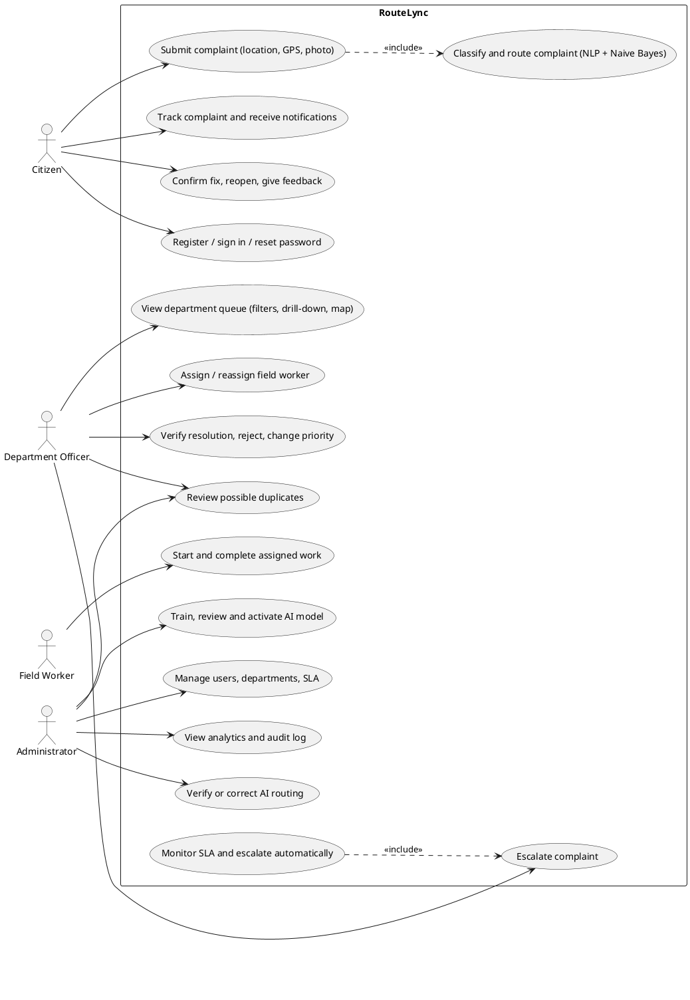
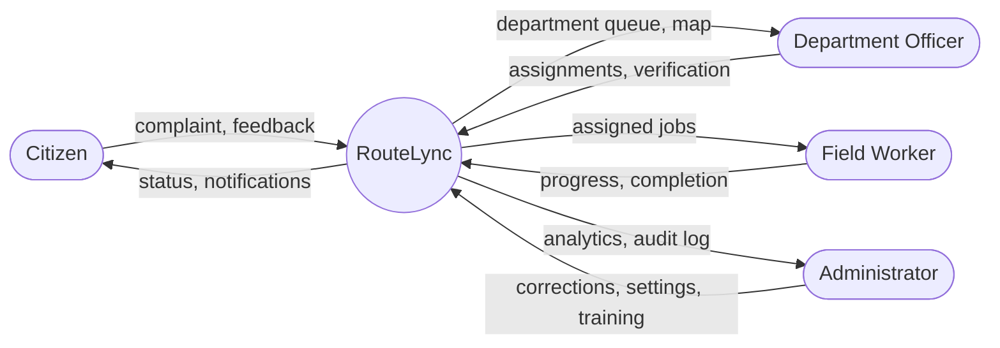
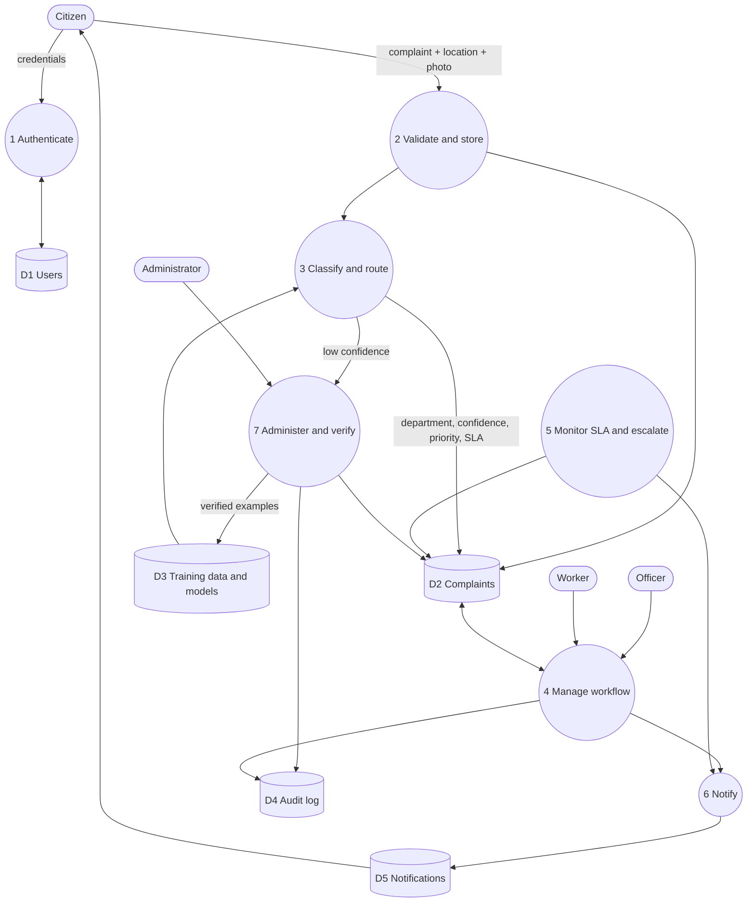
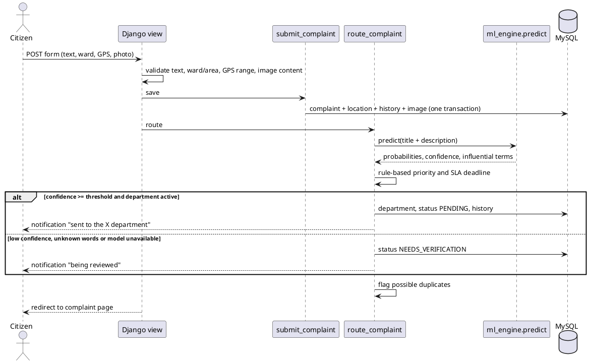
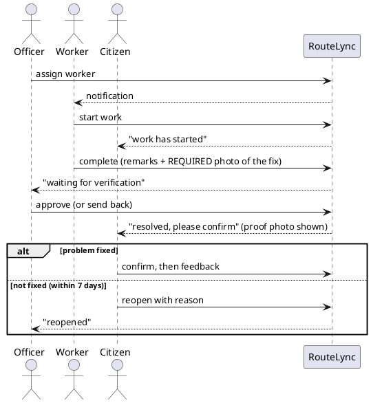

# Diagrams for the project report

Diagrams that must match the code are **generated from it**: run `python manage.py export_diagrams` to refresh
`er_diagram.mmd` (all 23 tables and relationships) and `lifecycle.mmd` (every allowed status change).
Mermaid diagrams render in VS Code (Markdown preview with a Mermaid extension), GitHub, or https://mermaid.live.
PlantUML diagrams render at https://www.plantuml.com/plantuml or in the VS Code PlantUML extension.

## 1. Use case diagram (PlantUML)


## 2. Data flow diagram, level 0 (Mermaid)


## 3. Data flow diagram, level 1 (Mermaid)


## 4. Class diagram (PlantUML, main classes)
```plantuml
@startuml
class User { email; full_name; phone; role; is_active }
class CitizenProfile { address }
class OfficerProfile { designation; is_department_head }
class FieldWorkerProfile { employee_code; is_available }
class Department { name; code; is_active }
class Area { name }
class Ward { number }
class Complaint { title; description; status; priority; ai_confidence; routing_method; sla_deadline; escalation_level }
class ComplaintLocation { street; landmark; address_text; latitude; longitude }
class ComplaintImage { image; kind }
class ComplaintStatusHistory { from_status; to_status; note; timestamp }
class ComplaintAssignment { assigned_at; ended_at }
class ComplaintRemark { text; visibility }
class Resolution { remarks; outcome }
class Feedback { rating; comment }
class EscalationEvent { level; reason; automatic }
class DuplicateFlag { similarity; status }
class RoutingCorrection { ai_was_correct; was_unrouted }
class TrainingSample { text; is_verified; source }
class MLModel { version; accuracy; conf_threshold; is_active }
class Notification { message; is_read }
class AuditLog { action; summary; timestamp }
User "1" -- "0..1" CitizenProfile
User "1" -- "0..1" OfficerProfile
User "1" -- "0..1" FieldWorkerProfile
Department "1" -- "*" OfficerProfile
Department "1" -- "*" FieldWorkerProfile
Area "1" -- "*" Ward
Ward "1" -- "*" ComplaintLocation
User "1" -- "*" Complaint : citizen
Department "0..1" -- "*" Complaint
Complaint "1" -- "1" ComplaintLocation
Complaint "1" -- "*" ComplaintImage
Complaint "1" -- "*" ComplaintStatusHistory
Complaint "1" -- "*" ComplaintAssignment
Complaint "1" -- "*" ComplaintRemark
Complaint "1" -- "*" Resolution
Complaint "1" -- "0..1" Feedback
Complaint "1" -- "*" EscalationEvent
Complaint "1" -- "*" DuplicateFlag
Complaint "1" -- "*" RoutingCorrection
MLModel "0..1" -- "*" Complaint : used for prediction
Department "1" -- "*" TrainingSample
User "1" -- "*" Notification
@enduml
```

## 5. Sequence diagram: submission and routing (PlantUML)


## 6. Sequence diagram: resolution (PlantUML)


## 7. Complaint lifecycle (Mermaid, generated)
Copy the contents of `docs/lifecycle.mmd`. Escalation is not a status: it is recorded as events and a level so work can continue.

## 8. Entity-relationship diagram (Mermaid, generated)
Copy the contents of `docs/er_diagram.mmd`. Notes for the report: ward numbers are unique per area; one active assignment per
complaint is enforced by a nullable unique column; GPS ranges, ratings and confidence values are enforced by database
check constraints; the area is derived from the ward rather than stored twice.
